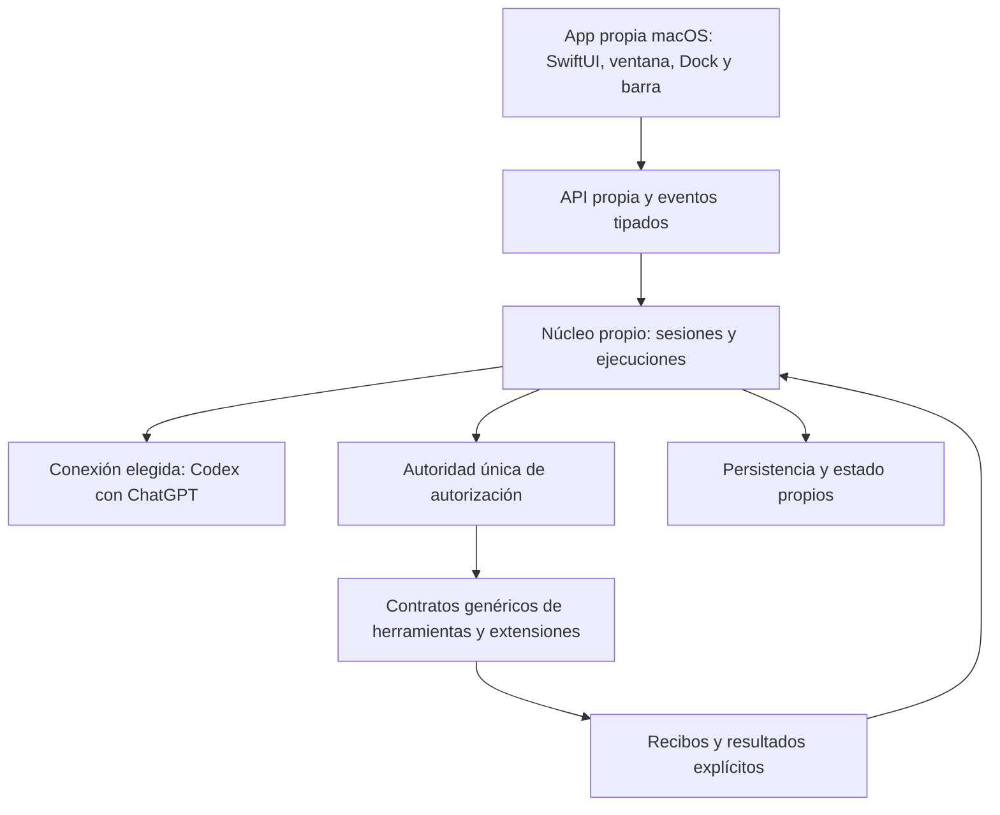

# Variante propia inspirada en OpenClaw — base limpia

Decisión del dueño, 24-10-2026: construir la nueva variante de Jarvis **en este
repositorio**, con implementación propia y arquitectura informada por el estudio
de OpenClaw. El clon externo es material de referencia. El producto nuevo no será
un fork ni una personalización de ese clon y no requerirá ejecutar OpenClaw.

El dueño precisó el orden: **fase A, variante completa funcional de OpenClaw con el nombre Jarvis;
fase B posterior, mejoras y herramientas adicionales de Jarvis**. El inventario de Jarvis preserva el alcance de
esa segunda fase y no autoriza adelantar su integración. Las herramientas, memoria, audio, nodos y canales que ya pertenecen a la base
OpenClaw se incluyen en A. Coincidir con un módulo histórico no las desplaza a B.
La [matriz de paridad](OPENCLAW_BASELINE_PARITY.md) sustituye el alcance reducido
del primer prototipo. Un chat funcional no cierra esta fase.

El árbol anterior fue retirado por petición del dueño. Ver [inicio limpio](CLEAN_START.md).
Los inventarios históricos están congelados; el código previo vive en Git.

Desde el 27-10-2026 las suites completas se cualifican en CI remota por elección
del dueño. Las comprobaciones locales requieren selección y presupuesto; los
hooks verifican fuentes e identidad sin repetir suites ni builds completos.
Ver [límites de pruebas y evidencia](TEST_RESOURCE_LIMITS.md).

El [bloque de memoria local](PHASE_A_MEMORY_INTELLIGENCE.md) añade MiniLM CPU,
búsqueda semántica/combinada, indexación de notas aprobadas y contexto por turno.
Su [registro de cualificación](PHASE_A_MEMORY_QUALIFICATION.json) conserva
intentos fallidos, pruebas con pesos reales y el recorrido nativo con ChatGPT.

El [bloque de MCP y extensiones](PHASE_A_MCP_EXTENSIONS.md) conecta transportes
HTTP/SSE, OAuth, recursos/prompts, Apps, relay, paquetes propios y versiones de
skills. Conserva separados implementación, pruebas focales y cualificación nativa.
La [continuación de cualificación](PHASE_A_MCP_EXTENSIONS_CLOSEOUT.md) está en
curso: conserva los fallos reales, correcciones, CI por checkpoint y recorridos
finales. La matriz reconoce ahora relay, paquetes y Apps como implementación
parcial, sin declarar completas sus familias ni todos los conectores del catálogo.

Se conservan el nombre de producto Jarvis, los identificadores técnicos `jarvis`,
la interfaz en español y las reglas de privacidad/aprobación. La primera conexión
de inferencia continúa siendo Codex con ChatGPT; NVIDIA está retirado del producto.
El cliente de la fase A será una app nativa de macOS en SwiftUI, con ventana propia,
Dock, barra de menús y atajo. Ver [contrato de escritorio](DESKTOP_APP.md).

## Registro que evita perder capacidades

| Registro | Contenido y límite |
| --- | --- |
| [Inventario backend](JARVIS_BACKEND_INVENTORY.md) | Dominios Python, herramientas fijas y dinámicas, canales, dispositivos, memoria, seguridad, CLI e integraciones. La presencia de código no demuestra configuración ni funcionamiento real. |
| [Inventario nativo](JARVIS_NATIVE_INVENTORY.md) | Módulos SwiftUI, productos SwiftPM, contratos, recursos, distribución, TCC, permisos y recorridos de paridad. |
| [Snapshot de declaraciones](JARVIS_DECLARATIONS.json) | Censo histórico con hashes y sitios AST de `ToolDefinition`; no describe herramientas activas en la base limpia y no se regenera en su lugar. |
| [Inventario OpenClaw](OPENCLAW_TREE_INVENTORY.json) | Identidad del árbol Git y recuento de todos sus archivos y ámbitos. Inventariar no significa revisar su código. |
| [Cobertura REA](REA_COVERAGE.json) | Partes examinadas, fuentes exactas, Evidence IDs, límites, incógnitas y partes pendientes. La cobertura global permanece parcial. |
| [Referencia de comportamiento](OPENCLAW_BEHAVIORAL_REFERENCE.md) | Observaciones trazables y contratos propios que orientan el diseño. No incorpora implementación de OpenClaw. |

Las capacidades heredadas no se borran de estos registros al cambiar de arquitectura.
Cada una necesita una decisión explícita: reconstruir, integrar, conservar tras
auditoría, dejar pendiente de configuración o retirar con motivo documentado. Un
estado «pendiente» nunca se presenta como función disponible.

Los snapshots históricos se conservan sin sobrescribir. Para generar un inventario
de investigación nuevo en una salida distinta, sin consultar credenciales ni historial:

```bash
.venv/bin/python script/research_inventory.py \
  --reference-root /ruta/al/material-de-referencia-openclaw \
  --output-directory /private/tmp/inventario-referencia-nuevo
```

## Arquitectura de la fase A



El núcleo decide el siguiente paso con un catálogo explícito. El modelo propone;
una única autoridad valida y autoriza el efecto. La interfaz, los proveedores y
los adaptadores no tienen rutas alternativas para eludir esa autoridad.

El diseño separa:

1. **Sesión:** identidad, contexto, modo plan y condición temporal. Una sesión
   temporal no adquiere persistencia ni memoria implícitas.
2. **Ejecución:** identificador, secuencia de eventos, presupuesto, estado visible y
   señal de asentamiento. Cancelar entrega un recibo; la limpieza puede continuar.
3. **Propuesta:** nombre ofrecido, argumentos validados y snapshot canónico. Una
   aprobación pertenece a esa propuesta exacta, conversación y ejecución.
4. **Efecto:** el adaptador ejecuta con señal de cancelación; la autoridad revalida
   permiso y parámetros inmediatamente antes de actuar.
5. **Resultado:** éxito técnico y resultado verificado son campos distintos.
   Un texto del modelo nunca prueba que una app cambió o una herramienta actuó.
6. **Recursos:** propietario y cierre de cada transporte, tarea, conexión MCP,
   observación y flujo de audio. La siguiente ejecución de una sesión espera que
   termine la limpieza anterior.

Estos contratos son decisiones propias. Se contrastan con la referencia mediante
especificaciones y pruebas, sin trasladar implementaciones ni recursos del proyecto externo.

## Primer núcleo ejecutable e integración de desarrollo

`src/jarvis_core/runtime.py` (`AgentRuntime`) contiene el prototipo propio del ciclo de ejecución.
Sus pruebas usan proveedores, herramientas y decisiones sintéticos. No tiene
acceso a la cuenta del dueño, TCC, herramientas del Mac ni datos personales.
Ahora se integra en el servicio propio `jarvis_core.service`, con SQLite, IPC
y Codex oficial. La app de desarrollo SwiftUI es nueva. Ninguno de esos hechos
acredita por sí solo una base completa ni cambia la app instalada del dueño.
Ver [verificación del recorrido inicial](BASELINE_VERTICAL_SLICE.md).
El siguiente bloque conecta herramientas, decisiones por operación, memoria local
y MCP a ese recorrido; su [registro](PHASE_A_TOOLS_MEMORY_MCP.md) distingue pruebas
de contrato, verificación con Codex y capacidades que siguen pendientes.

La [continuación de canales, voz local y web](PHASE_A_CHANNELS_VOICE_WEB.md) y su
[registro de cualificación](PHASE_A_CHANNELS_VOICE_WEB_QUALIFICATION.json) separan
controles previos, ajustes posteriores y recorridos reales todavía pendientes.
No declaran completa la fase A ni sustituyen la instalación anterior.

El [bloque de recuperación y diagnóstico](PHASE_A_RECOVERY.md) añade revisiones
del host, respaldo portátil, preparación de un perfil restaurado desarmado e
inspección sin reparación. Distingue los contratos y pruebas de la cualificación
en la app y de la distribución todavía pendiente.
La [partición OC-18](REA_PART18_SUMMARY.json) continúa la lectura de adquisición
SQLite privada y limpieza retenida. Su [contrato propio WAL](PHASE_A_COLD_WAL_CONTRACT.md)
tiene un [primer incremento implementado](PHASE_A_WAL_RECOVERY.md) para respaldo y
diagnóstico de familias compatibles, con fuentes intactas. Su recorrido acotado
de respaldo y restauración GUI tiene evidencia independiente separada.

La [continuación de recuperación](PHASE_A_RECOVERY_COMPLETION.md) implementa seis
bloques: variantes WAL ausente/vacío/cabecera, journals SQLite compatibles,
archivos/artefactos de workspace, reparación FTS y de prefijo WAL, actualización
y rollback locales. Los motores y el host tienen pruebas con SQLite, archivos,
procesos y decisiones sintéticos. El [registro de cualificación](PHASE_A_RECOVERY_COMPLETION_QUALIFICATION.json)
acredita copia/restauración de archivos, respaldo con journal caliente, reparación
FTS/restauración e instalación/actualización/rollback con decisiones del dueño,
datos sintéticos y comprobaciones independientes. La v1 recuperada arrancó con su
pareja app/Python y cerró correctamente, sin cuenta conectada. Pasaron 2297 pruebas
Python, 249 Swift y controles de paquetes/bundle; las variantes y negativos no
repetidos en GUI conservan su límite explícito.
La reparación publica otra copia; la actualización conserva el perfil y exige
una copia verificada actual y esquemas compatibles. El arranque explícito valida
la pareja app/Python de un mismo CURRENT y los esquemas fríos; no admite un
perfil restaurado ni invierte migraciones de datos.

El [cierre nativo posterior](PHASE_A_RECOVERY_NATIVE_CLOSEOUT.md) completa los
puntos de variantes y negativas solicitados: 16 revisiones de la matriz finita y
tres rechazos desde la interfaz, publicaciones IPC con oráculos independientes
y prefijos publicados/restaurados en perfiles sintéticos con decisiones reales
y delegadas. El modo explícito `--recovery-only` evita consumir los WAL/journals
durante la carga automática de conversaciones y tareas. Se corrigieron la
localización y caducidad de las tarjetas, la prioridad entre operaciones y la
retirada de tickets tras perder el servicio. La [investigación de arranque](PHASE_A_STARTUP_ISOLATION.md)
acredita reproducciones controladas y aislamiento del intérprete elegido.
Estos recorridos no atribuyen retrospectivamente una causa de sistema precisa
al incidente histórico ni acreditan un canal de distribución completo.

La [continuación de activación, memoria y canales](PHASE_A_RECONCILIATION_CLOSEOUT.md)
amplía la copia de ámbitos a WAL/journals íntegros y añade reconciliación local
de rutas Telegram con la autoridad central. Habilitar o revocar una ruta conserva
su sesión e historia; no conecta el bot ni restaura permisos. La activación del canal
exige después un claim fresco del chat por nonce, con prueba sólo en RAM y
validación de conexión, ruta, agente y workspace. Se descarta el primer segundo
parcial de entrada para impedir consumir mensajes anteriores al arranque.
Las regresiones de activación amplían los negativos; la interfaz comprueba el
plazo de revisión además del ticket. Se registran 14 casos nativos, reinicios
desconectados, 2402 pruebas Python y 305 Swift aprobadas. La evidencia conserva
los fallos previos y sus correcciones. Los hooks vuelven a comprobar el árbol
congelado al publicar; las cifras anteriores siguen siendo checkpoints históricos.

Este canal `development` utiliza Python y Codex oficial externos. No acredita
autenticidad completa, distribución autocontenida, Developer ID, notarización o
canal remoto firmado. La instalación personal anterior permanece independiente.
El [cierre de núcleo y sesiones](PHASE_A_CORE_CLOSEOUT.md) añade identidad local
Ed25519 con admisión/revocación, recuperación del servicio sin reconexión ni
replay, compactación conservadora, ramas con CAS y recibos durables, objetivos
de hasta cuatro hijos y presupuestos, cola y corrección de turno exacto. Todos
tienen controles SwiftUI y pruebas Python/Swift integradas. Se comprobaron nueve
decisiones nativas delegadas, escritura hija por hash, recuperación con
Mantenimiento abierto y persistencia tras reabrir la app, usando sólo un perfil
y un peer de modelo sintéticos. Los controles integrados incluyen 2540 pruebas
Python y 332 Swift. Esto no repite la inferencia autenticada del recorrido inicial.
La CI inicial descubrió un fallo del smoke con caché nueva; el guard usa ahora
directamente el lock offline y tiene cuatro regresiones causales, sin alterar
las fuentes productivas ya cualificadas. El cierre conserva ese fallo y su corrección.

La investigación [OC-21A](REA_PART21A_CORE_SERVICE.json),
[OC-21B](REA_PART21B_SUMMARY.json) y [OC-21C](REA_PART21C_SUMMARY.json)
dejó el checkpoint de núcleo en 23 lotes y 90 fuentes TS/JS seleccionadas.
El [checkpoint de herramientas del Mac y navegador](PHASE_A_MAC_BROWSER_CLOSEOUT.md)
añade [OC-22A](REA_PART22A_SUMMARY.json), [OC-22B1/B2](REA_PART22B_SUMMARY.json)
y [OC-22C](REA_PART22C_SUMMARY.json): **27 lotes y 105 rutas TS/JS únicas**,
con incógnitas estáticas y dependencias sin revisar. No es revisión exhaustiva
ni ejecución de OpenClaw. Ese checkpoint conservaba 47 avances parciales y 33
sin implementación. Tras reconciliar MCP, plugins y Apps, la matriz registra
**51 avances parciales y 29 sin implementación**, ninguna familia completa;
esas cifras no son porcentajes de producto terminado. El registro REA vigente
incluye también memoria y MCP: **38 lotes, 144 rutas TS/JS únicas** (142 TS).
A-71 y la fase A siguen abiertas y la fase B continúa aplazada.

Este incremento implementa parches multiarchivo con CAS, PTY confinada de un
solo proceso, observación/acciones AX de ventana exacta y frame sólo en RAM,
navegador WebKit no persistente, conexión CDP explícita, búsqueda configurada,
descarga al workspace y gestión nativa de permisos/revocación. Conserva una
autoridad y recibos independientes del texto del modelo. Cancelar no demuestra
terminar JavaScript ya despachado: callback y limpieza pendientes retienen el
lane sin replay. No se promete un shell arbitrario ni todos los sitios posibles.
El [registro JSON](PHASE_A_MAC_BROWSER_CLOSEOUT.json) fija los focales disponibles
y sus hashes: 151 Python de patch/PTY/custodia, 52 de broker/permisos, selección
integrada de 108 y 39 nativos de Mac/navegador/auditoría. Se solapan; no se suman.
La ejecución completa pasó **2672 Python** en 488,93 s, sin cambios Python
posteriores, y **392 Swift**, con una omisión opt-in y cero fallos, en 154,796 s.
Se conservan los checkpoints previos de 2670 y 382. La corrección AX posterior
separa ACK y postcondición: tiene cinco tests nuevos y un focal de 33 aprobado;
los 392 anteriores no la cubren. Chrome real pasó su caso opt-in en 2,945 s.
El [manifiesto](PHASE_A_MAC_BROWSER_SOURCE_MANIFEST.json) conserva 173 identidades
históricas Python, el checkpoint de 355 y las 356 actuales verificadas.

La app completó **55 operaciones por RPC firmado**, con WebKit y Chrome propios
reales, patch, descarga, PTY y una apertura pública HTTPS por el proxy sin
excepción sintética. No son 55 efectos exitosos: se conservan los negativos.
Un corte posterior inmutable de 13 operaciones prueba AX entre procesos con
texto Unicode/UTF-16, un frame real de 14.300 bytes y descarga publicada; el press
anterior sigue incierto pese al contador externo 1 y no se repite. El SDK es
sintético. La selección nativa de «Siempre» y su reutilización en otro chat ya
pasaron por CUA y un observador sin decisiones RPC. El bundle 04 verificó una
operación nueva 0→1 y frame de 12.352 bytes: el destino previo había salido y
su regla no se heredó. La regla nueva persistió al reiniciar los mismos bytes;
requiere resolver/ventana explícitos para revalidar handles nativos en RAM antes
de la lectura automática autorizada. Revocación UI y rechazo posterior pasaron
sin despacho; la limpieza dejó cero permisos y cero acciones sin resolver.
La identidad dedicada con TCC efectivo usa la excepción puntual explícita del
dueño y Touch ID suyo; las credenciales siguen reservadas al dueño.
Paquete/smoke y hooks finales, commit/push y CI se registrarán tras observarlos;
la estrategia usa el commit que contiene el cierre, sin autoatestiguar un SHA
futuro. Este cierre es el snapshot previo al propio commit; sus resultados Git/CI
posteriores figuran en los metadatos de hooks y la respuesta final. Este bloque
no cambia la instalación personal ni completa la fase A.

El prototipo original probaba serialización por sesión,
propuesta/validación/autorización, resultado explícito, cancelación y asentamiento.
Sus límites históricos no se atribuyen a los incrementos cualificados de arriba:
la identidad de clave local firmada ya no depende sólo del token. Esa identidad
no es atestación del binario por Apple ni aislamiento contra malware del mismo
usuario. El producto actual continúa siendo una distribución de desarrollo.

El Runtime actual incorpora límites de pasos/tiempo y conserva el propietario
mientras su limpieza o persistencia no se asientan. Un callback de confianza que
no termine puede seguir impidiendo el asentamiento; no se resuelve declarando
éxito o liberando su lane. La custodia de procesos cubre hijos cooperativos de
los adaptadores propios, no descendientes externos arbitrarios.
Los recibos sintéticos no son firmas IPC ni acreditan TCC o efectos físicos.
El texto final lleva procedencia `model`; los recibos de acciones se presentan
por separado y no verifican automáticamente las frases del modelo.

## Orden de implementación y cierre

La tabla siguiente describe el desglose inicial, **no el alcance completo**. La
matriz de paridad incluye las familias restantes y fija la condición de cierre.
Las mejoras específicas de Jarvis solo empiezan después de acreditar toda A.

| Etapa | Entregable y condición para pasar |
| --- | --- |
| A0 — Inventario y referencia | Catálogos conservados, identidad de referencia fijada y cobertura por partes sin declaraciones de exhaustividad falsas. |
| A1 — Núcleo propio | Pruebas adversariales del ciclo, cancelación, asentamiento, validación, autorización exacta y presupuesto. El prototipo actual cubre solo el contrato inicial. |
| A2 — Estado y recuperación propios | Sesiones, eventos, persistencia, temporalidad, reinicio y resultados inciertos; no reutilizar bases privadas del dueño para probar. |
| A3 — Proveedor y app de escritorio | Conexión oficial aislada del proveedor elegido, chat, catálogo, streaming, cancelación y consulta siguiente; cliente propio SwiftUI con ventana, Dock, barra y atajo, coherente con el estado real y sin panel web incrustado. |
| A4 — Extensibilidad de la base | Registro, contratos de plugins/MCP, propiedad de conexiones, política y recibos. Pruebas con herramientas de fixture, sin las integraciones específicas de Jarvis. |
| A5 — Cualificación de la variante base | Recorrido real de conversación y fixture de herramienta autorizado, reinicio, recuperación y aislamiento; paquete propio reproducible. La fase A todavía no está terminada. |
| B1 — Herramientas Jarvis | Solo después de A5: recuperar las familias de ambos inventarios con decisiones explícitas, adaptadores y pruebas reales por capacidad. |
| B2 — Memoria personal y producto nativo | Integrar cifrado, recuperación semántica, interfaz, Dot, proyectos, tareas, canales y dispositivos de Jarvis con migración reversible y paridad. |
| B3 — Computadora, navegador y audio | Integrar y verificar observación/acciones del Mac, navegador y cadena de voz de Jarvis. TextEdit con aprobación/revocación y nueva línea preservando contenido son casos obligatorios. |
| B4 — Sustitución del producto | Paridad real acreditada, migración ensayada con datos sintéticos, reversión y decisiones del dueño. Entonces se conecta e instala el producto nuevo. |

La referencia OpenClaw tiene decenas de miles de archivos. Se estudia por partes:
cada una fija fuentes/hashes, relaciones examinadas, incógnitas, comportamiento
observado y especificación resultante. Los archivos no examinados siguen pendientes.
El estado «complete-within-view» de REA describe una vista, nunca el proyecto entero.

## Qué cambia en la forma de verificar

- Cada módulo tiene contrato y recorrido observable antes de ampliar su alcance.
- Las pruebas unitarias y dobles se etiquetan como sintéticos.
- Las pruebas reales usan datos de prueba y registran evidencia del resultado.
- Se prueban variaciones de lenguaje, errores, cancelación, reinicio y revocación,
  además del caso feliz. Una frase específica que funciona no certifica una familia.
- El dueño introduce contraseñas, concede TCC y aprueba acciones reales. El agente
  nunca sustituye esas decisiones ni lee `auth.json` o el historial personal.
- Las incidencias y pendientes originales de [V1](../V1_PENDIENTES.md) conservan su
  trazabilidad. El inventario no marca resueltas esas incidencias por cambiar de núcleo.
