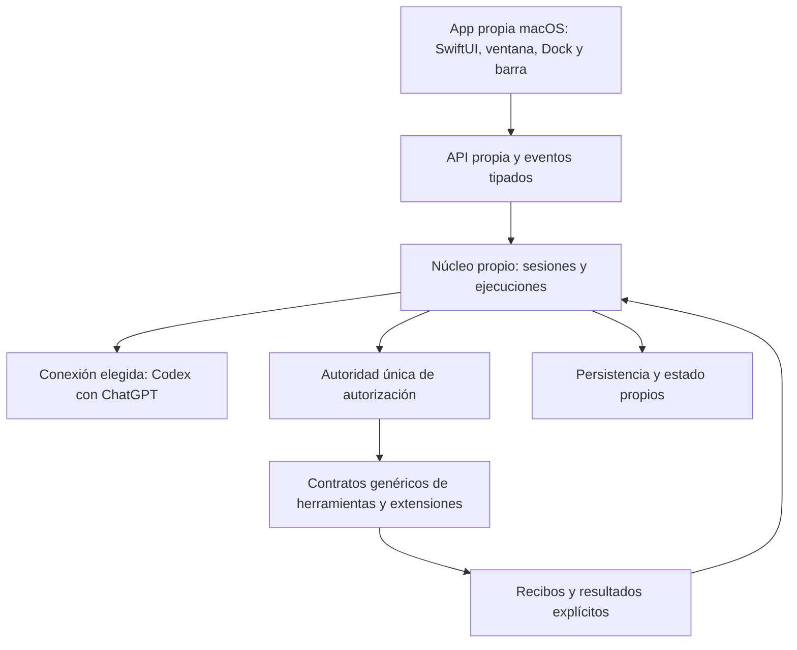

# Variante propia inspirada en OpenClaw — base limpia

Decisión del dueño, 24-10-2026: construir la nueva variante de Jarvis **en este
repositorio**, con implementación propia y arquitectura informada por el estudio
de OpenClaw. El clon externo es material de referencia. El producto nuevo no será
un fork ni una personalización de ese clon y no requerirá ejecutar OpenClaw.

El dueño precisó el orden: **fase A, variante completa funcional de OpenClaw con el nombre Jarvis;
fase B posterior, mejoras y herramientas adicionales de Jarvis**. El inventario de Jarvis preserva el alcance de
esa segunda fase y no autoriza adelantar su integración. Las herramientas, memoria, audio, nodos y canales que ya pertenecen a la base
OpenClaw se incluyen en A. Coincidir con un módulo histórico no las desplaza a B.
La [matriz de paridad](OPENCLAW_BASELINE_PARITY.md) sustituye el alcance reducido
del primer prototipo. Un chat funcional no cierra esta fase.

El árbol anterior fue retirado por petición del dueño. Ver [inicio limpio](CLEAN_START.md).
Los inventarios históricos están congelados; el código previo vive en Git.

Se conservan el nombre de producto Jarvis, los identificadores técnicos `jarvis`,
la interfaz en español y las reglas de privacidad/aprobación. La primera conexión
de inferencia continúa siendo Codex con ChatGPT; NVIDIA está retirado del producto.
El cliente de la fase A será una app nativa de macOS en SwiftUI, con ventana propia,
Dock, barra de menús y atajo. Ver [contrato de escritorio](DESKTOP_APP.md).

## Registro que evita perder capacidades

| Registro | Contenido y límite |
| --- | --- |
| [Inventario backend](JARVIS_BACKEND_INVENTORY.md) | Dominios Python, herramientas fijas y dinámicas, canales, dispositivos, memoria, seguridad, CLI e integraciones. La presencia de código no demuestra configuración ni funcionamiento real. |
| [Inventario nativo](JARVIS_NATIVE_INVENTORY.md) | Módulos SwiftUI, productos SwiftPM, contratos, recursos, distribución, TCC, permisos y recorridos de paridad. |
| [Snapshot de declaraciones](JARVIS_DECLARATIONS.json) | Censo histórico con hashes y sitios AST de `ToolDefinition`; no describe herramientas activas en la base limpia y no se regenera en su lugar. |
| [Inventario OpenClaw](OPENCLAW_TREE_INVENTORY.json) | Identidad del árbol Git y recuento de todos sus archivos y ámbitos. Inventariar no significa revisar su código. |
| [Cobertura REA](REA_COVERAGE.json) | Partes examinadas, fuentes exactas, Evidence IDs, límites, incógnitas y partes pendientes. La cobertura global permanece parcial. |
| [Referencia de comportamiento](OPENCLAW_BEHAVIORAL_REFERENCE.md) | Observaciones trazables y contratos propios que orientan el diseño. No incorpora implementación de OpenClaw. |

Las capacidades heredadas no se borran de estos registros al cambiar de arquitectura.
Cada una necesita una decisión explícita: reconstruir, integrar, conservar tras
auditoría, dejar pendiente de configuración o retirar con motivo documentado. Un
estado «pendiente» nunca se presenta como función disponible.

Los snapshots históricos se conservan sin sobrescribir. Para generar un inventario
de investigación nuevo en una salida distinta, sin consultar credenciales ni historial:

```bash
.venv/bin/python script/research_inventory.py \
  --reference-root /ruta/al/material-de-referencia-openclaw \
  --output-directory /private/tmp/inventario-referencia-nuevo
```

## Arquitectura de la fase A



El núcleo decide el siguiente paso con un catálogo explícito. El modelo propone;
una única autoridad valida y autoriza el efecto. La interfaz, los proveedores y
los adaptadores no tienen rutas alternativas para eludir esa autoridad.

El diseño separa:

1. **Sesión:** identidad, contexto, modo plan y condición temporal. Una sesión
   temporal no adquiere persistencia ni memoria implícitas.
2. **Ejecución:** identificador, secuencia de eventos, presupuesto, estado visible y
   señal de asentamiento. Cancelar entrega un recibo; la limpieza puede continuar.
3. **Propuesta:** nombre ofrecido, argumentos validados y snapshot canónico. Una
   aprobación pertenece a esa propuesta exacta, conversación y ejecución.
4. **Efecto:** el adaptador ejecuta con señal de cancelación; la autoridad revalida
   permiso y parámetros inmediatamente antes de actuar.
5. **Resultado:** éxito técnico y resultado verificado son campos distintos.
   Un texto del modelo nunca prueba que una app cambió o una herramienta actuó.
6. **Recursos:** propietario y cierre de cada transporte, tarea, conexión MCP,
   observación y flujo de audio. La siguiente ejecución de una sesión espera que
   termine la limpieza anterior.

Estos contratos son decisiones propias. Se contrastan con la referencia mediante
especificaciones y pruebas, sin trasladar implementaciones ni recursos del proyecto externo.

## Primer núcleo ejecutable e integración de desarrollo

`src/jarvis_core/runtime.py` (`AgentRuntime`) contiene el prototipo propio del ciclo de ejecución.
Sus pruebas usan proveedores, herramientas y decisiones sintéticos. No tiene
acceso a la cuenta del dueño, TCC, herramientas del Mac ni datos personales.
Ahora se integra en el servicio propio `jarvis_core.service`, con SQLite, IPC
y Codex oficial. La app de desarrollo SwiftUI es nueva. Ninguno de esos hechos
acredita por sí solo una base completa ni cambia la app instalada del dueño.
Ver [verificación del recorrido inicial](BASELINE_VERTICAL_SLICE.md).
El siguiente bloque conecta herramientas, decisiones por operación, memoria local
y MCP a ese recorrido; su [registro](PHASE_A_TOOLS_MEMORY_MCP.md) distingue pruebas
de contrato, verificación con Codex y capacidades que siguen pendientes.

La [continuación de canales, voz local y web](PHASE_A_CHANNELS_VOICE_WEB.md) y su
[registro de cualificación](PHASE_A_CHANNELS_VOICE_WEB_QUALIFICATION.json) separan
controles previos, ajustes posteriores y recorridos reales todavía pendientes.
No declaran completa la fase A ni sustituyen la instalación anterior.

El [bloque de recuperación y diagnóstico](PHASE_A_RECOVERY.md) añade revisiones
del host, respaldo portátil, preparación de un perfil restaurado desarmado e
inspección sin reparación. Distingue los contratos y pruebas de la cualificación
en la app y de la activación, actualización y distribución todavía pendientes.
La [partición OC-18](REA_PART18_SUMMARY.json) continúa la lectura de adquisición
SQLite privada y limpieza retenida. Su [contrato propio WAL](PHASE_A_COLD_WAL_CONTRACT.md)
tiene un [primer incremento implementado](PHASE_A_WAL_RECOVERY.md) para respaldo y
diagnóstico de familias compatibles, con fuentes intactas. Journals, variantes
WAL restantes y cualificación real completa siguen pendientes de la fase A.

El prototipo prueba serialización por sesión, propuesta/validación/autorización,
resultado explícito, cancelación y asentamiento. El prototipo aislado no acredita permisos persistentes, cifrado, herramientas
reales ni voz. El servicio añadido tiene pruebas separadas de autenticación local,
recuperación de SQLite e IPC; token local no equivale a identidad firmada. Es el primer contrato ejecutable de la reconstrucción,
no una nueva versión funcional de la app.

Límites adicionales del prototipo: `max_steps` acota las propuestas, no el tiempo
total de un callback ni la profundidad/tamaño de sus argumentos. Un callback de
confianza que no termine puede impedir el asentamiento. La retención de sesiones
y la recuperación de una sesión cuyo cierre falló requieren diseño productivo.
Los recibos sintéticos no son firmas IPC ni acreditan TCC o efectos físicos.
El texto final lleva procedencia `model`; los recibos de acciones se presentan
por separado y no verifican automáticamente las frases del modelo.

## Orden de implementación y cierre

La tabla siguiente describe el desglose inicial, **no el alcance completo**. La
matriz de paridad incluye las familias restantes y fija la condición de cierre.
Las mejoras específicas de Jarvis solo empiezan después de acreditar toda A.

| Etapa | Entregable y condición para pasar |
| --- | --- |
| A0 — Inventario y referencia | Catálogos conservados, identidad de referencia fijada y cobertura por partes sin declaraciones de exhaustividad falsas. |
| A1 — Núcleo propio | Pruebas adversariales del ciclo, cancelación, asentamiento, validación, autorización exacta y presupuesto. El prototipo actual cubre solo el contrato inicial. |
| A2 — Estado y recuperación propios | Sesiones, eventos, persistencia, temporalidad, reinicio y resultados inciertos; no reutilizar bases privadas del dueño para probar. |
| A3 — Proveedor y app de escritorio | Conexión oficial aislada del proveedor elegido, chat, catálogo, streaming, cancelación y consulta siguiente; cliente propio SwiftUI con ventana, Dock, barra y atajo, coherente con el estado real y sin panel web incrustado. |
| A4 — Extensibilidad de la base | Registro, contratos de plugins/MCP, propiedad de conexiones, política y recibos. Pruebas con herramientas de fixture, sin las integraciones específicas de Jarvis. |
| A5 — Cualificación de la variante base | Recorrido real de conversación y fixture de herramienta autorizado, reinicio, recuperación y aislamiento; paquete propio reproducible. La fase A todavía no está terminada. |
| B1 — Herramientas Jarvis | Solo después de A5: recuperar las familias de ambos inventarios con decisiones explícitas, adaptadores y pruebas reales por capacidad. |
| B2 — Memoria personal y producto nativo | Integrar cifrado, recuperación semántica, interfaz, Dot, proyectos, tareas, canales y dispositivos de Jarvis con migración reversible y paridad. |
| B3 — Computadora, navegador y audio | Integrar y verificar observación/acciones del Mac, navegador y cadena de voz de Jarvis. TextEdit con aprobación/revocación y nueva línea preservando contenido son casos obligatorios. |
| B4 — Sustitución del producto | Paridad real acreditada, migración ensayada con datos sintéticos, reversión y decisiones del dueño. Entonces se conecta e instala el producto nuevo. |

La referencia OpenClaw tiene decenas de miles de archivos. Se estudia por partes:
cada una fija fuentes/hashes, relaciones examinadas, incógnitas, comportamiento
observado y especificación resultante. Los archivos no examinados siguen pendientes.
El estado «complete-within-view» de REA describe una vista, nunca el proyecto entero.

## Qué cambia en la forma de verificar

- Cada módulo tiene contrato y recorrido observable antes de ampliar su alcance.
- Las pruebas unitarias y dobles se etiquetan como sintéticos.
- Las pruebas reales usan datos de prueba y registran evidencia del resultado.
- Se prueban variaciones de lenguaje, errores, cancelación, reinicio y revocación,
  además del caso feliz. Una frase específica que funciona no certifica una familia.
- El dueño introduce contraseñas, concede TCC y aprueba acciones reales. El agente
  nunca sustituye esas decisiones ni lee `auth.json` o el historial personal.
- Las incidencias y pendientes originales de [V1](../V1_PENDIENTES.md) conservan su
  trazabilidad. El inventario no marca resueltas esas incidencias por cambiar de núcleo.
